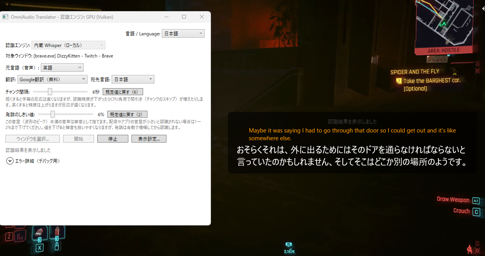
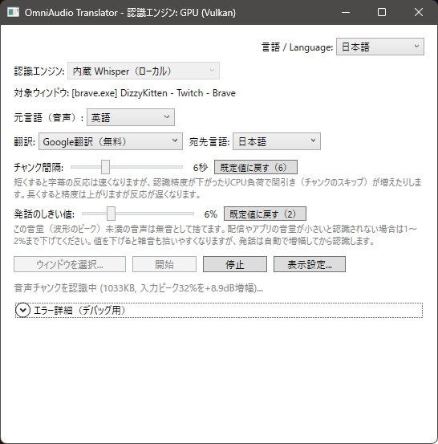
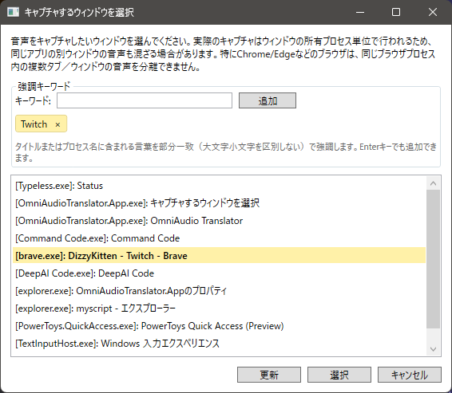

# OmniAudio Translator

**English** | [日本語](README.md)

A Windows desktop app that captures audio from any application (process) in real time, transcribes it locally, translates it, and displays the result as a subtitle overlay.



- Audio capture: Windows Process Loopback Capture API (`ActivateAudioInterfaceAsync` + `AUDIOCLIENT_ACTIVATION_TYPE_PROCESS_LOOPBACK`)
- Speech recognition: built-in [Whisper.net](https://github.com/sandroandrade/Whisper.net) (default; no external Python process, model downloaded automatically on first launch). Groq's cloud Whisper is also available for weak GPUs (API key required)
- Translation: Google Translate (free, no API key required) / DeepL / Gemini
- Display: click-through subtitle overlay (font size, color, and background opacity are configurable)
- UI: Japanese / English
- Settings and API keys are stored in `%AppData%\OmniAudioTranslator\` (API keys are protected with Windows DPAPI)

## Download

Prebuilt Windows x64 builds are available from [Releases](https://github.com/KAWAchan-jp/OmniAudio-Translator-app/releases/latest) (no .NET runtime installation required).

## Requirements

- Windows 10 Build 20348 or later / Windows 11 (Process Loopback Capture is required)
- .NET 8 Desktop Runtime (the .NET 8 SDK is required to build)
- Groq cloud recognition (optional): a Groq API key (free tier available) and an internet connection (the built-in Whisper works offline)

## Build

```powershell
git clone https://github.com/KAWAchan-jp/OmniAudio-Translator-app.git
cd OmniAudio-Translator-app
dotnet build OmniAudioTranslator.sln
```

To create a distributable build for Windows:

```powershell
dotnet publish src/OmniAudioTranslator.App/OmniAudioTranslator.App.csproj `
  -c Release -r win-x64 --self-contained false -o publish
```

## Usage



1. Launch `OmniAudioTranslator.App.exe`
2. Click "Select Window" and choose the window whose audio you want to subtitle
3. Set the recognition engine (built-in Whisper / Groq), source language, target language, and translation provider (Google Translate needs no API key)
4. Press "Start"; audio from the target app is transcribed and translated at a fixed interval (6 seconds by default) and shown in the overlay

### Recognition engine (built-in Whisper / Groq)

The default is the built-in Whisper.net, which works without extra configuration. If your GPU is weak or you prefer not to use the local GPU, select "Groq (Cloud)" as the recognition engine and enter a Groq API key.

- `whisper-large-v3-turbo`: fast and low-cost (default), best for conversation and live subtitles
- `whisper-large-v3`: more accurate but slower and costlier, best for hard-to-hear audio and technical terms

#### Getting a free Groq API key

1. Open the [Groq Console](https://console.groq.com/keys)
2. Sign in with Google, GitHub, or another account (creating an account is free)
3. Click "Create API Key", give it a name, and create it
4. Copy the key (`gsk_...`) and paste it into the "Groq API key" field in the app
5. Select "Groq (Cloud)" and a Groq model, then start

The free tier is also rate-limited. Limits and available models may change, so check the latest details in the Groq dashboard/docs.

When Groq is selected, each audio chunk (WAV) is sent to the Groq API (`https://api.groq.com/openai/v1/audio/transcriptions`). The API key is protected with DPAPI and stored with the other keys. For rate limits (HTTP 429) or authentication errors (401), the "Error details" panel shows the status and response body.

### Window picker

The list is shown as `[exe.exe]: title`. Register words under "Highlight keywords" to highlight rows whose title or process name contains them (case-insensitive) with a pale yellow background and bold text. Press Enter or click "Add" to register a keyword, and click "×" on a chip to remove it. If no keywords are registered, the list is displayed normally. The settings are saved.



To use DeepL or Gemini, enter the corresponding API key in the app.

## Tests

```powershell
dotnet test tests/OmniAudioTranslator.Core.Tests/OmniAudioTranslator.Core.Tests.csproj
```

## Known limitations

- Audio capture works at the process level. If the same executable has multiple windows open, their audio cannot be separated
- In particular, Chromium-based browsers such as Google Chrome and Microsoft Edge play audio from all tabs and windows in the same browser process, so a single tab cannot be isolated. Audio from other tabs will be mixed in. To translate only one tab, mute the other tabs or use a separate browser profile (a separate process)
- This is because the Windows audio capture API only supports isolation at the application (process) level. Regular desktop apps such as games, VLC, Spotify, and standalone radio apps run audio in their own processes, so they can be captured separately
- Speech recognition runs locally by default (built-in Whisper). When Groq is selected, audio data is sent to Groq's cloud. Use the built-in Whisper if you are offline or do not want audio sent externally. Groq's free tier is rate-limited
- For translation, the recognized text is sent to the selected translation provider
- The subtitle overlay is displayed on screen (it may not appear above exclusive fullscreen applications)

## License

MIT License (see `LICENSE`)
