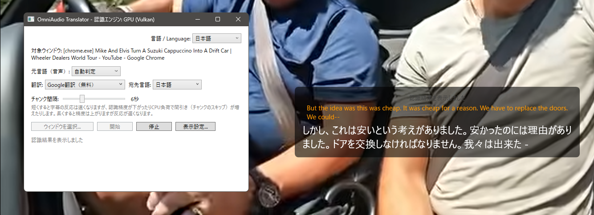

# OmniAudio Translator

**English** | [日本語](README.md)

A Windows desktop app that captures audio from any application (process) in real time, transcribes it locally, translates it, and displays the result as a subtitle overlay.



- Audio capture: Windows Process Loopback Capture API (`ActivateAudioInterfaceAsync` + `AUDIOCLIENT_ACTIVATION_TYPE_PROCESS_LOOPBACK`)
- Speech recognition: built-in [Whisper.net](https://github.com/sandroandrade/Whisper.net) (no external Python process). The model is downloaded automatically on first launch
- Translation: Google Translate (free, no API key required) / DeepL / Gemini
- Display: click-through subtitle overlay (font size, color, and background opacity are configurable)
- UI: Japanese / English
- Settings and API keys are stored in `%AppData%\OmniAudioTranslator\` (API keys are protected with Windows DPAPI)

## Requirements

- Windows 10 Build 20348 or later / Windows 11 (Process Loopback Capture is required)
- .NET 8 Desktop Runtime (the .NET 8 SDK is required to build)

## Build

```powershell
git clone https://github.com/KAWAchan-jp/OmniAudio-Translator-app.git
cd OmniAudio-Translator-app
dotnet build OmniAudioTranslator.sln
```

To create a distributable build for Windows:

```powershell
dotnet publish src/OmniAudioTranslator.App/OmniAudioTranslator.App.csproj `
  -c Release -r win-x64 --self-contained false -o publish
```

## Usage

1. Launch `OmniAudioTranslator.App.exe`
2. Click "Select Window" and choose the window whose audio you want to subtitle
3. Set the source language, target language, and translation provider (Google Translate needs no API key)
4. Press "Start"; audio from the target app is transcribed and translated at a fixed interval (6 seconds by default) and shown in the overlay

To use DeepL or Gemini, enter the corresponding API key in the app.

## Tests

```powershell
dotnet test tests/OmniAudioTranslator.Core.Tests/OmniAudioTranslator.Core.Tests.csproj
```

## Known limitations

- Audio capture works at the process level. If the same executable has multiple windows open, their audio cannot be separated
- Speech recognition runs locally, but recognized text is sent to the selected provider for translation
- The subtitle overlay is displayed on screen (it may not appear above exclusive fullscreen applications)

## License

MIT License (see `LICENSE`)
