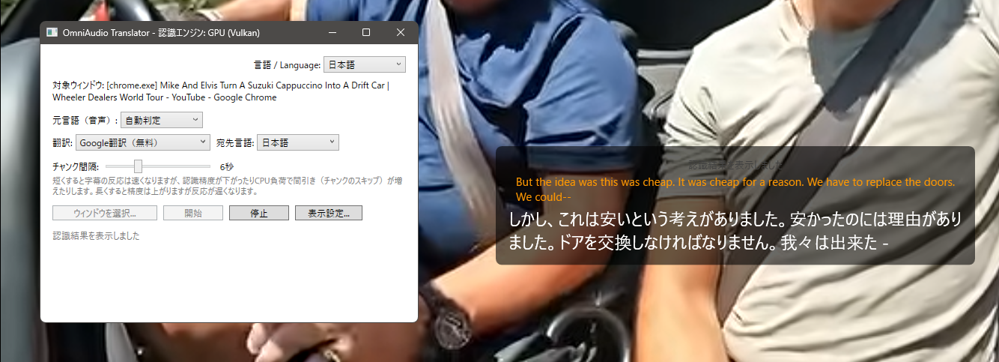
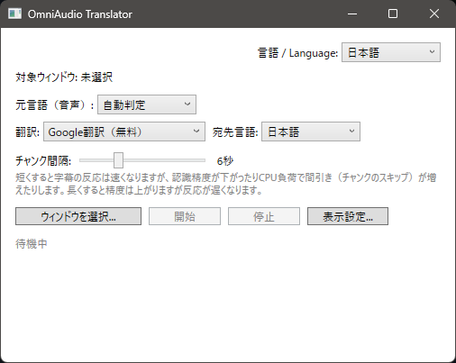

# OmniAudio Translator

[English](README.en.md) | **日本語**

Windows 上で任意のアプリ（プロセス）の音声だけをリアルタイムに取り込み、ローカル音声認識 → 翻訳して字幕オーバーレイとして表示するデスクトップアプリです。



- 音声キャプチャ: Windows の Process Loopback Capture API（`ActivateAudioInterfaceAsync` + `AUDIOCLIENT_ACTIVATION_TYPE_PROCESS_LOOPBACK`）
- 音声認識: [Whisper.net](https://github.com/sandroandrade/Whisper.net) をアプリに内蔵（Python などの外部プロセス不要）。初回起動時にモデルを自動ダウンロードします
- 翻訳: Google 翻訳（無料・APIキー不要）/ DeepL / Gemini
- 表示: クリックスルー可能な字幕オーバーレイ（フォントサイズ・色・背景の不透明度を変更可能）
- UI: 日本語 / English 切り替え
- 設定と API キーは `%AppData%\OmniAudioTranslator\` に保存（API キーは Windows DPAPI で保護）

## ダウンロード

ビルド済みの Windows x64 版は [Releases](https://github.com/KAWAchan-jp/OmniAudio-Translator-app/releases/latest) からダウンロードできます（.NET ランタイムのインストール不要）。

## 動作環境

- Windows 10 Build 20348 以降 / Windows 11（Process Loopback Capture が必要なため）
- .NET 8 Desktop Runtime（ビルドには .NET 8 SDK）

## ビルド

```powershell
git clone https://github.com/KAWAchan-jp/OmniAudio-Translator-app.git
cd OmniAudio-Translator-app
dotnet build OmniAudioTranslator.sln
```

Windows 向けに配布用の実行ファイルを作る場合:

```powershell
dotnet publish src/OmniAudioTranslator.App/OmniAudioTranslator.App.csproj `
  -c Release -r win-x64 --self-contained false -o publish
```

## 使い方



1. `OmniAudioTranslator.App.exe` を起動
2. 「ウィンドウを選択」から字幕を取りたいアプリのウィンドウを選ぶ
3. 元言語・翻訳先言語・翻訳プロバイダを設定（Google 翻訳は API キー不要）
4. 「開始」を押すと、対象アプリの音声が一定間隔（既定 6 秒）で認識・翻訳され、オーバーレイに表示されます

DeepL / Gemini を使う場合は、それぞれの API キーを画面に入力してください。

## テスト

```powershell
dotnet test tests/OmniAudioTranslator.Core.Tests/OmniAudioTranslator.Core.Tests.csproj
```

## 既知の制限

- 音声キャプチャはプロセス単位です。同じ exe の複数ウィンドウを開いている場合、それらの音声は分離できません
- 音声認識はローカルで行いますが、翻訳時は認識したテキストを選択したプロバイダへ送信します
- 字幕オーバーレイは Windows の画面上に表示されます（排他フルスクリーンアプリの上には表示できない場合があります）

## ライセンス

MIT License（`LICENSE` を参照）
