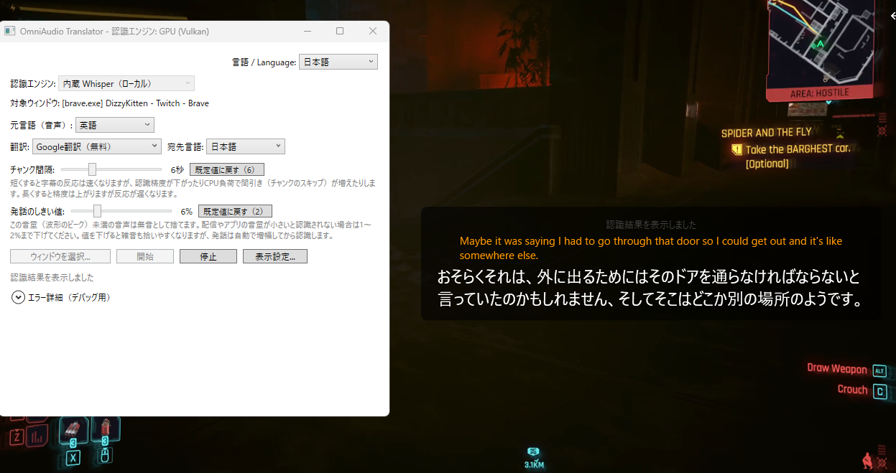
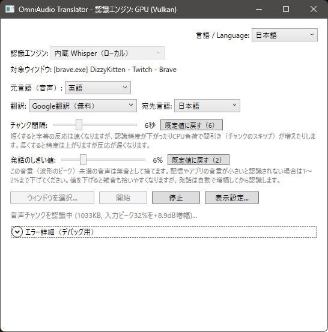
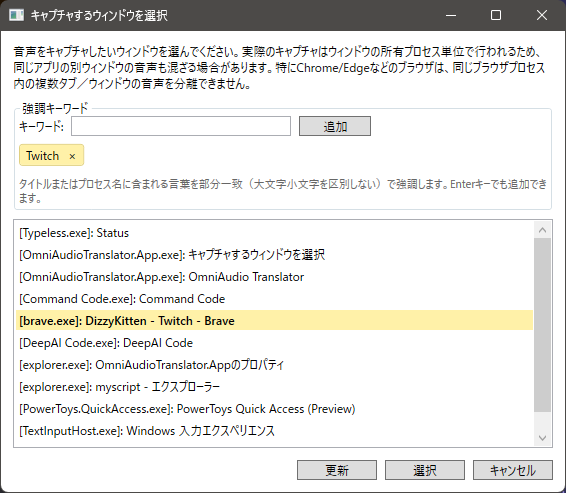

# OmniAudio Translator

[English](README.en.md) | **日本語**

Windows 上で任意のアプリ（プロセス）の音声だけをリアルタイムに取り込み、ローカル音声認識 → 翻訳して字幕オーバーレイとして表示するデスクトップアプリです。



- 音声キャプチャ: Windows の Process Loopback Capture API（`ActivateAudioInterfaceAsync` + `AUDIOCLIENT_ACTIVATION_TYPE_PROCESS_LOOPBACK`）
- 音声認識: [Whisper.net](https://github.com/sandroandrade/Whisper.net) をアプリに内蔵（既定。Python などの外部プロセス不要、初回起動時にモデルを自動ダウンロード）。GPU が弱い環境向けに Groq のクラウド Whisper も選択可能（API キーが必要）
- 翻訳: Google 翻訳（無料・APIキー不要）/ DeepL / Gemini
- 表示: クリックスルー可能な字幕オーバーレイ（フォントサイズ・色・背景の不透明度を変更可能）
- UI: 日本語 / English 切り替え
- 設定と API キーは `%AppData%\OmniAudioTranslator\` に保存（API キーは Windows DPAPI で保護）

## ダウンロード

ビルド済みの Windows x64 版は [Releases](https://github.com/KAWAchan-jp/OmniAudio-Translator-app/releases/latest) からダウンロードできます（.NET ランタイムのインストール不要）。

## 動作環境

- Windows 10 Build 20348 以降 / Windows 11（Process Loopback Capture が必要なため）
- .NET 8 Desktop Runtime（ビルドには .NET 8 SDK）
- Groq のクラウド認識を使う場合: Groq API キー（無料枠あり）とインターネット接続（内蔵 Whisper はオフラインで動作）

## ビルド

```powershell
git clone https://github.com/KAWAchan-jp/OmniAudio-Translator-app.git
cd OmniAudio-Translator-app
dotnet build OmniAudioTranslator.sln
```

Windows 向けに配布用の実行ファイルを作る場合:

```powershell
dotnet publish src/OmniAudioTranslator.App/OmniAudioTranslator.App.csproj `
  -c Release -r win-x64 --self-contained false -o publish
```

## 使い方



1. `OmniAudioTranslator.App.exe` を起動
2. 「ウィンドウを選択」から字幕を取りたいアプリのウィンドウを選ぶ
3. 認識エンジン（内蔵 Whisper / Groq）と元言語・翻訳先言語・翻訳プロバイダを設定（Google 翻訳は API キー不要）
4. 「開始」を押すと、対象アプリの音声が一定間隔（既定 6 秒）で認識・翻訳され、オーバーレイに表示されます

### 認識エンジン（内蔵 Whisper / Groq）

既定はアプリ内蔵の Whisper.net で、追加設定なしで動作します。GPU が弱い環境やローカル GPU を使いたくない場合は、認識エンジンで「Groq（クラウド）」を選び、Groq API キーを入力してください。

- `whisper-large-v3-turbo`: 高速・低コスト（既定）。会話や配信のリアルタイム字幕向け
- `whisper-large-v3`: 高精度・低速・高コスト。聞き取りにくい音声や専門用語向け

#### Groq API キーの取得（無料）

1. [Groq Console](https://console.groq.com/keys) を開く
2. Google / GitHub などのアカウントでログイン（アカウント作成は無料）
3. 「Create API Key」を押し、名前を付けて作成
4. 表示されたキー（`gsk_...`）をコピーして、アプリの「Groq APIキー」欄に貼り付ける
5. 認識エンジンで「Groq（クラウド）」、Groq モデルを選択して開始

無料枠にもレート制限があります。上限や利用可能なモデルは変更される場合があるため、最新の条件は Groq のダッシュボード／ドキュメントで確認してください。

Groq を選ぶと、音声チャンク（WAV）が Groq API（`https://api.groq.com/openai/v1/audio/transcriptions`）へ送信されます。API キーは他のキーと同様に DPAPI で保護して保存されます。レート制限（HTTP 429）や認証エラー（401）が発生した場合は、画面の「エラー詳細」にステータスと応答本文が表示されます。

### ウィンドウ選択画面

一覧は `[exe.exe]: タイトル` 形式で表示されます。「強調キーワード」に語を登録すると、タイトルまたはプロセス名に部分一致（大文字小文字を区別しない）した行が淡黄背景＋太字で強調され、目的のウィンドウを探しやすくなります。キーワードは Enter キーまたは「追加」で登録し、チップの「×」で削除できます（未登録なら通常表示）。設定は保存されます。



DeepL / Gemini を使う場合は、それぞれの API キーを画面に入力してください。

## テスト

```powershell
dotnet test tests/OmniAudioTranslator.Core.Tests/OmniAudioTranslator.Core.Tests.csproj
```

## 既知の制限

- 音声キャプチャはプロセス単位です。同じ exe の複数ウィンドウを開いている場合、それらの音声は分離できません
- 特に Google Chrome / Microsoft Edge などの Chromium 系ブラウザは、同じブラウザプロセス内の複数タブ・複数ウィンドウの音声を分離できません。選んだウィンドウ以外のタブの音も混ざります。ブラウザの一部のタブだけを翻訳したい場合は、他のタブをミュートするか、別プロファイルのブラウザ（別プロセス）を使ってください
- 上記は Windows の音声キャプチャ API がアプリ（プロセス）単位までしか対応していないためです。ゲーム・VLC・Spotify・単体のラジオアプリなど、アプリごとに音声プロセスが分かれるソフトは分離できます
- 音声認識は既定ではローカル（内蔵 Whisper）で行います。Groq を選ぶと音声データが Groq のクラウドへ送信されます。オフライン環境や音声を外部送信したくない場合は内蔵 Whisper を使ってください。Groq の無料枠にはレート制限があります
- 翻訳時は、認識したテキストを選択した翻訳プロバイダへ送信します
- 字幕オーバーレイは Windows の画面上に表示されます（排他フルスクリーンアプリの上には表示できない場合があります）

## ライセンス

MIT License（`LICENSE` を参照）
